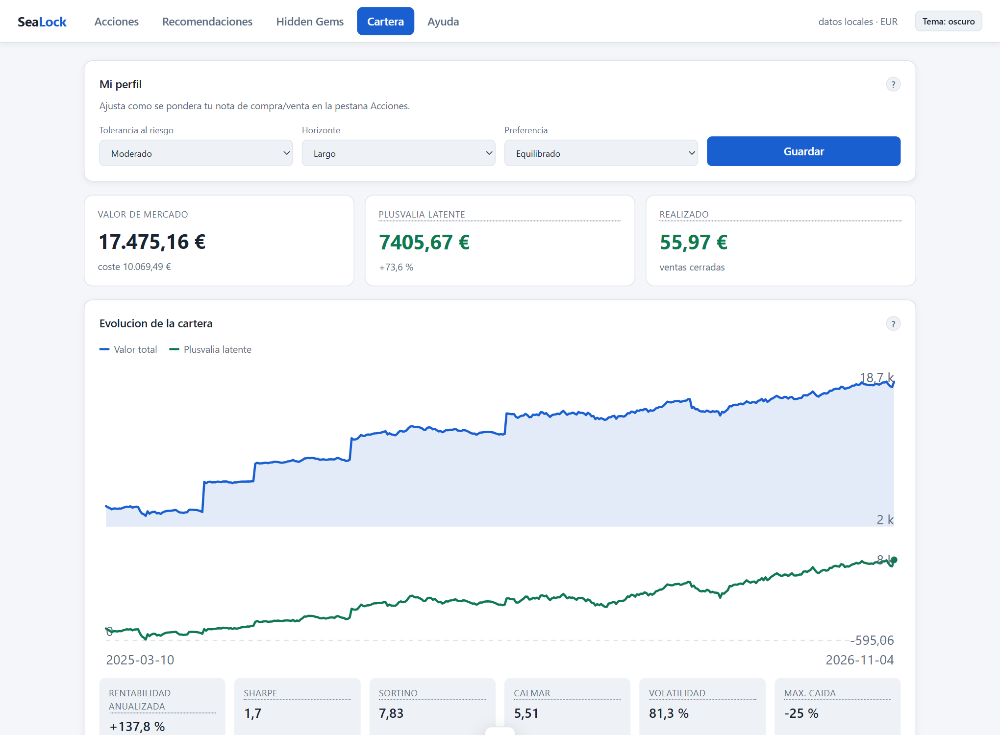
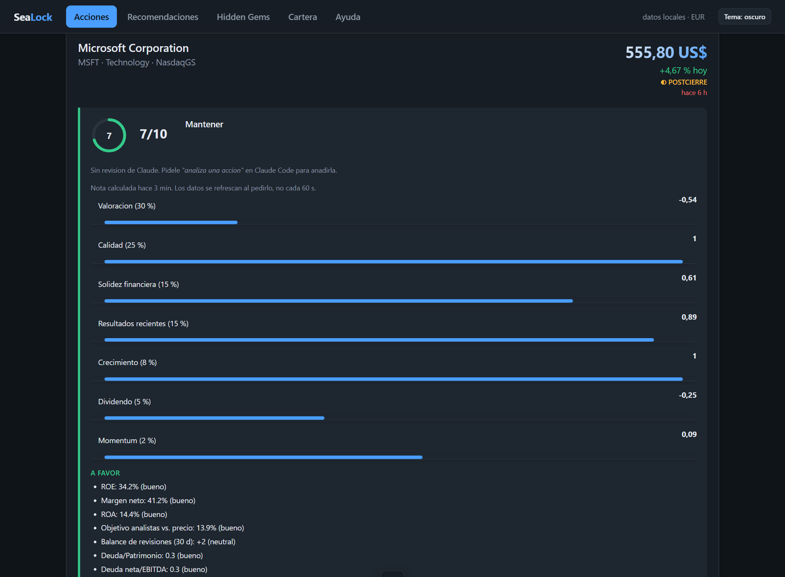
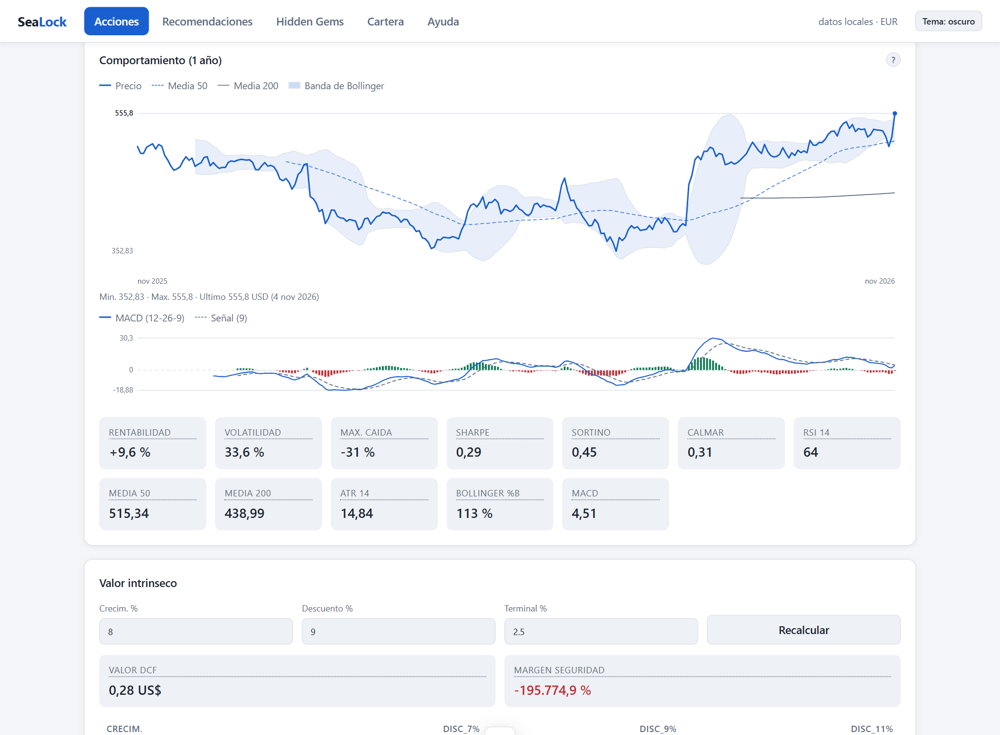
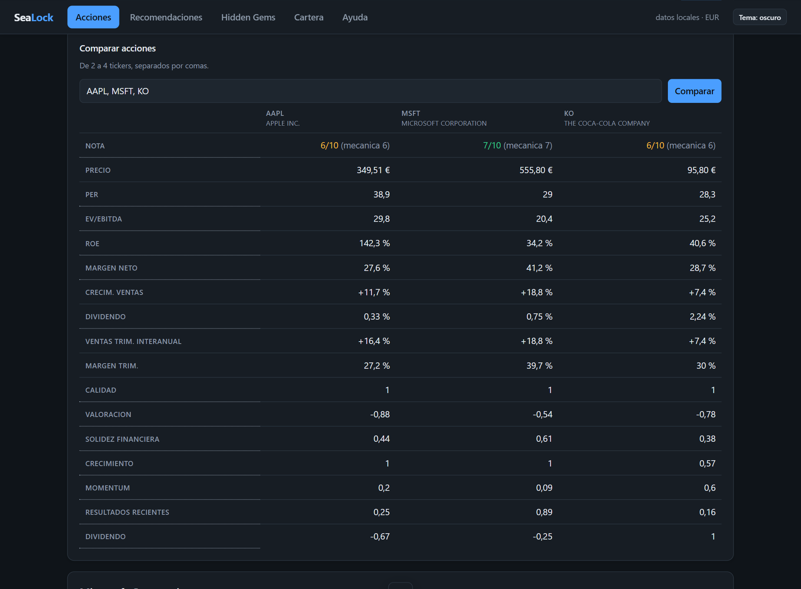
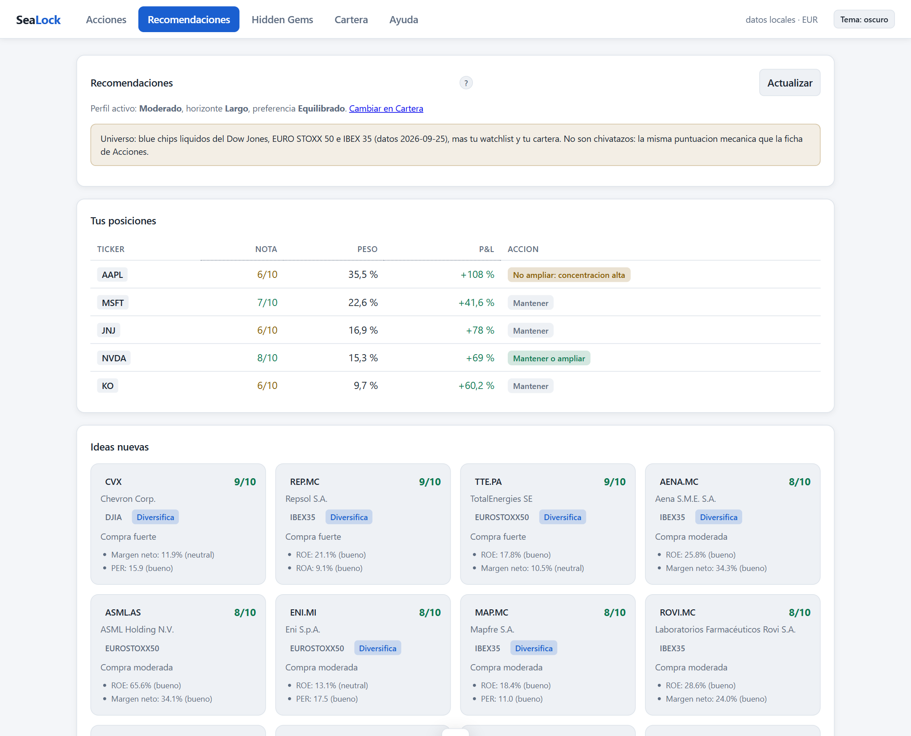

<div align="center">

# SeaLock

**Local-first stock investing, scored for your investor profile.**

Track your portfolio and watchlist, and get a transparent 1–10 buy/sell score for any listed company — all on your own machine. No account, no cloud, no dependencies.




</div>

> The interface is in Spanish (it started as a personal tool); the code, API and docs are in English.

## Why SeaLock

- **Private by design.** Everything lives in a local SQLite file. The web server binds to `127.0.0.1` only, and market data is fetched with plain `GET` requests to public sources — your holdings are never sent anywhere.
- **A score you can audit.** Every company gets a 1–10 note built from seven pillars (quality, valuation, financial strength, recent results, growth, momentum, dividend). Each metric, weight and source is visible — no black box.
- **Tuned to *you*.** Pillar weights shift with your risk tolerance, horizon and income-vs-growth preference.
- **Zero dependencies.** Standard-library Python only. No `pip install`, no build step, no frameworks in the frontend.
- **Two ways in, one engine.** Use the web UI, or talk to it through [Claude Code](https://claude.com/claude-code) via two MCP servers and three skills. Both work on the same database.

## Screenshots

<table>
<tr>
<td width="50%"><br><sub><b>Score breakdown</b> — pillar sub-scores, pros and cons, data coverage.</sub></td>
<td width="50%"><br><sub><b>Price chart</b> — SMA 50/200, Bollinger band, MACD, Sharpe/Sortino/Calmar.</sub></td>
</tr>
<tr>
<td width="50%"><br><sub><b>Compare</b> — 2 to 4 tickers side by side.</sub></td>
<td width="50%"><br><sub><b>Recommendations</b> — advice per position and new ideas from a blue-chip universe.</sub></td>
</tr>
</table>

*Screenshots use a throwaway demo portfolio, not real data.*

## Features

| Area | What you get |
|---|---|
| **Stock sheet** | Quote with price age, fundamentals, news, DCF (editable assumptions + sensitivity table), Graham number, quarterly results, analyst estimate revisions, and the 1–10 score. |
| **Portfolio** | Positions with average-cost P/L, weights, realised gains, multi-currency handling, export to CSV/JSON, and a point-in-time evolution curve versus a benchmark. |
| **Recommendations** | Per-position action (hold, don't add, review thesis, consider selling) and new ideas scanned from Dow Jones + EURO STOXX 50 + IBEX 35. |
| **Hidden Gems** | Background scan of small/mid caps worldwide (a local catalogue of ~44,600 symbols), cached across restarts. |
| **Risk metrics** | Sharpe, Sortino, Calmar, max drawdown, volatility. The annualisation factor is derived from the actual dates, not assumed. |
| **Technicals** | SMA/EMA, RSI (Wilder), ATR, Bollinger Bands, MACD — vendored from [talipp](https://github.com/nardew/talipp) (MIT). |
| **Alerts** | Price, moving-average and RSI threshold alerts. They state a fact; they never tell you what to buy. |
| **Light & dark themes** | Palette lives in CSS variables; contrast measured against WCAG AA. |

## Quick start

**Requirement: Python 3.9 or newer.** Nothing else to install.

```bash
git clone https://github.com/ShiroKuro-hen/SeaLock.git
cd SeaLock
python app/servidor.py
```

Then open <http://127.0.0.1:8765>. On Windows you can also double-click `SeaLock.bat`.

Your data is created on first run in `datos/finanzas.db` (git-ignored). Set `SEALOCK_DATA` to keep it elsewhere and `SEALOCK_CURRENCY` to change the base currency (default `EUR`).

## Use it from Claude Code

Open Claude Code in this folder; `.mcp.json` registers the two servers and the skills load automatically.

| You say | What happens |
|---|---|
| "I bought 10 shares of AAPL at 178" | The trade is recorded in your portfolio |
| "Analyse Inditex" | Quote, fundamentals, news, valuation and score |
| "What is Nvidia really worth?" | DCF + Graham with a sensitivity table |
| "Anything new on my stocks?" | News filtered by materiality |
| "Set my profile to aggressive, long term" | Updates the profile that weights the score |

- **`finance`** — local SQLite only, **no network access**: trades, watchlist, investor profile, alerts, read-only SQL, backups.
- **`market`** — public market data: quotes, history, fundamentals, news, earnings, DCF, Graham, FX, and `stock_score`.
- **Skills** (`.claude/skills/`) — `analizar-accion`, `valor-intrinseco`, `radar-noticias`.

## How the score works

`mcp/scoring.py` is a pure module (no network, no I/O). Each pillar yields metrics in `[-1, 1]`; the weights depend on your profile and sum to 100.

| Pillar | Moderate weight | Metrics |
|---|---|---|
| Quality | 25 | ROE, net/operating margin, ROA |
| Valuation | 25 | P/E, PEG, EV/EBITDA, P/B, DCF and Graham margin, analyst target (half weight) |
| Financial strength | 15 | Debt/equity, current ratio, net debt/EBITDA, free-cash-flow sign |
| Recent results | 15 | YoY sales and EPS growth, margin change, consistency, EPS surprise |
| Growth | 8 | YoY sales and earnings growth |
| Momentum | 7 | Price vs 50/200-day averages, 12-month return, RSI, MACD, Bollinger %B, ATR |
| Dividend | 5 | Yield, payout |

Pillars with no data are dropped and their weight is redistributed; coverage under 50% raises a warning. Four red flags cap the score at 3 (unsustainable payout, high leverage with falling profits, long-term downtrend with deteriorating fundamentals, three straight quarters of falling sales).

Criteria draw on Buffett, Graham, Lynch, Greenblatt, Piotroski, AQR's quality-minus-junk and Jegadeesh–Titman momentum. Analyst consensus is only a weak tie-breaker, because sell-side optimism bias is well documented. Full details are in [`CLAUDE.md`](CLAUDE.md#criterios-de-la-nota).

> **No look-ahead.** Every historical series and portfolio curve follows a strict point-in-time rule: a signal computed on day T is only acted on at T+1, and portfolio metrics use the position *as it was on that date*.

## Project layout

```
SeaLock/
├─ app/            Local HTTP server + JSON API, and the vanilla-JS frontend (app/web)
├─ mcp/            MCP servers (finance, market), scoring engine, indicators, metrics, symbol catalogue
├─ recursos/       Stock universe and the worldwide symbol catalogue
├─ .claude/skills/ Claude Code skills
├─ pruebas/        End-to-end test suites
├─ docs/           Plan and repo research, screenshots
└─ datos/          Your database and backups (git-ignored, never share)
```

The web layer does not duplicate logic: it imports the MCP modules and calls their functions, so any new MCP tool is automatically available over the API.

## Security and privacy

- Binds to `127.0.0.1` only.
- A random per-launch token is required for every `/api` call, and non-local `Host`/`Origin` headers are rejected, so other browser tabs cannot reach it (DNS rebinding).
- `finance` has no network code at all; `market` only issues `GET` requests and never sends your data.

## Tests

```bash
python pruebas/prueba_humo.py   # MCP servers + scoring, metrics and indicators
python pruebas/prueba_web.py    # web API, security defences, UI rendering
```

Both use temporary databases and never touch your real data. Network failures are reported as warnings, not failures.

## Data sources

Yahoo Finance (prices, fundamentals, news), Google News (news) and Stooq (price fallback) — all free, no API key. Coverage of European companies on Yahoo is noticeably worse (no market cap, share count or free cash flow for tickers like `ITX.MC`); SeaLock derives what it can, marks it as derived, and otherwise fails loudly instead of inventing a number. If Yahoo tightens access, add a free [Finnhub](https://finnhub.io) or [FMP](https://financialmodelingprep.com) key to the `market` server's `env` block in `.mcp.json`.

## Disclaimer

SeaLock is a personal tool. The score is a **mechanical rule-based rating on public data, not financial advice** and not the opinion of a licensed professional. Prices may be delayed ~15 minutes and fundamentals may contain errors. The decision is always yours.
